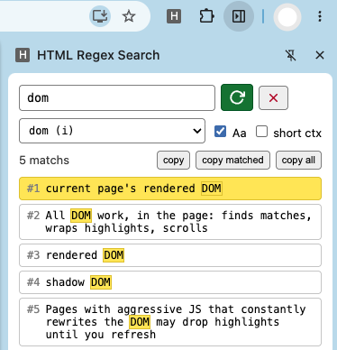

# HTML Regex Search

A minimal Chrome extension (Manifest V3) that searches the **current page's rendered DOM** with a JavaScript regular expression — highlights every match in place, lists them in Chrome's native side panel, and jumps to any match on click.

No contenteditable hacks, no page modifications beyond highlight spans, no background activity: type a regex, hit refresh, done.



## Features

- **Regex search box** with a one-click **⟳ Refresh** button (and a **✕ Clear** button to remove all highlights)
- **Highlights in the page** — every match wrapped in a yellow span; the currently selected match flashes orange as the page scrolls to it
- **Results list in the native side panel** — each result shows the full text of the string containing the match (wrapping, never truncated), with the match marked
  - **Short context mode** (checkbox): show only ±2 words around each match
- **Click a result** → the page smoothly scrolls to that exact match
- **Copy buttons** next to the match count:
  - `copy` — the full displayed text of the selected result
  - `copy matched` — just the matched text
  - `copy all` — every result, one per line with `----` between them (respects short-context mode)
- **`Aa` checkbox** — case-insensitive search
- **Saved-regex dropdown** — your last 15 regexes, pick one to re-run instantly
- **Zero-friction install** — the content script auto-injects on demand, so you never need to reload a page after installing or updating the extension

## Setup

1. Clone or download this repository.
2. Open Chrome and go to `chrome://extensions`.
3. Enable **Developer mode** (top-right toggle).
4. Click **Load unpacked** and select this repository's folder.
5. Pin the **Open Regex Search** toolbar button (puzzle-piece icon → pin).

That's it. No build step — plain JavaScript, no dependencies.

## Usage

1. Open any web page.
2. Click the toolbar button to open the side panel (it stays open until you close it).
3. Type a regex in the box (plain JavaScript regex syntax, e.g. `\b\d{3,}\b`, `TODO|FIXME`, `https?://\S+`), or pick one from the saved-regex dropdown.
4. Hit **⟳** (or press Enter) to search:
   - Matches are highlighted in the page
   - The panel shows the match count and a scrollable results list
5. Click any result to scroll the page to that match (it flashes orange for ~3 seconds).
6. Toggle **Aa** for case-insensitive search and **short ctx** to compact the list.
7. **✕** clears all highlights and results; clearing the box and refreshing does the same.

Invalid regexes show their exact engine error in the status line.

## How it works

| Piece | Role |
|---|---|
| `manifest.json` | MV3: `sidePanel` + `action` + `scripting` + `storage` permissions, content script on all URLs |
| `background.js` | One job: open the side panel on toolbar click |
| `panel.html` / `panel.js` | The side panel UI — input, buttons, results list, clipboard, history |
| `content.js` | All DOM work, in the page: finds matches, wraps highlights, scrolls |

The panel and the page talk over `chrome.runtime` messages:

- `hrx-refresh { regex, flags }` → count + match list (text, context)
- `hrx-clear` → remove all highlight spans (text is normalized back)
- `hrx-scroll { id }` → scroll to a highlighted span + orange flash

Search walks every text node with a `TreeWalker` (skipping `<script>`/`<style>`), collects all hits on the unmodified tree first, then wraps them — which avoids the classic bug of mutating text nodes mid-iteration. If a tab was opened before the extension was installed, the panel injects the content script on demand via `chrome.scripting` and retries — no manual reload needed.

## Known limitations

- Searches the **rendered DOM**, not the raw HTML source
- Matches **inside iframes** and **shadow DOM** are not found
- A match must live inside a **single text node** — text split across elements (e.g. `foo <b>bar</b>`) won't match as a whole
- Pages with aggressive JS that constantly rewrites the DOM may drop highlights until you refresh

## Project layout

```
├── manifest.json     # MV3 manifest
├── background.js     # opens the side panel
├── content.js        # in-page search + highlighting
├── panel.html        # side panel UI
├── panel.js          # side panel logic
└── PLAN.md           # original design plan
```
